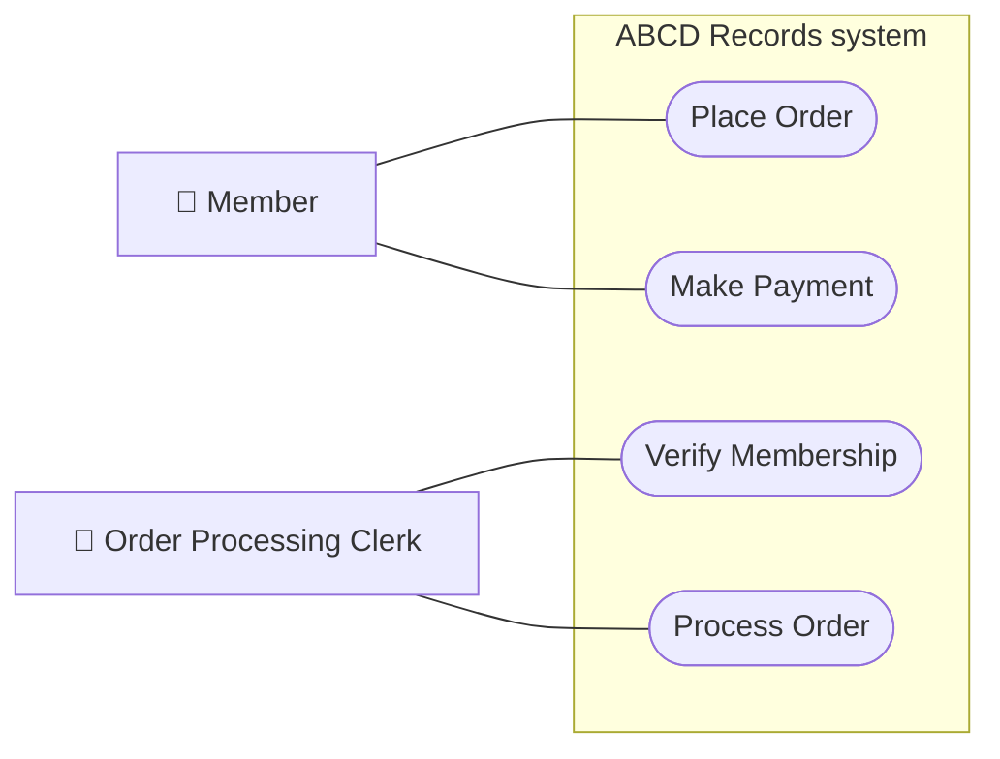
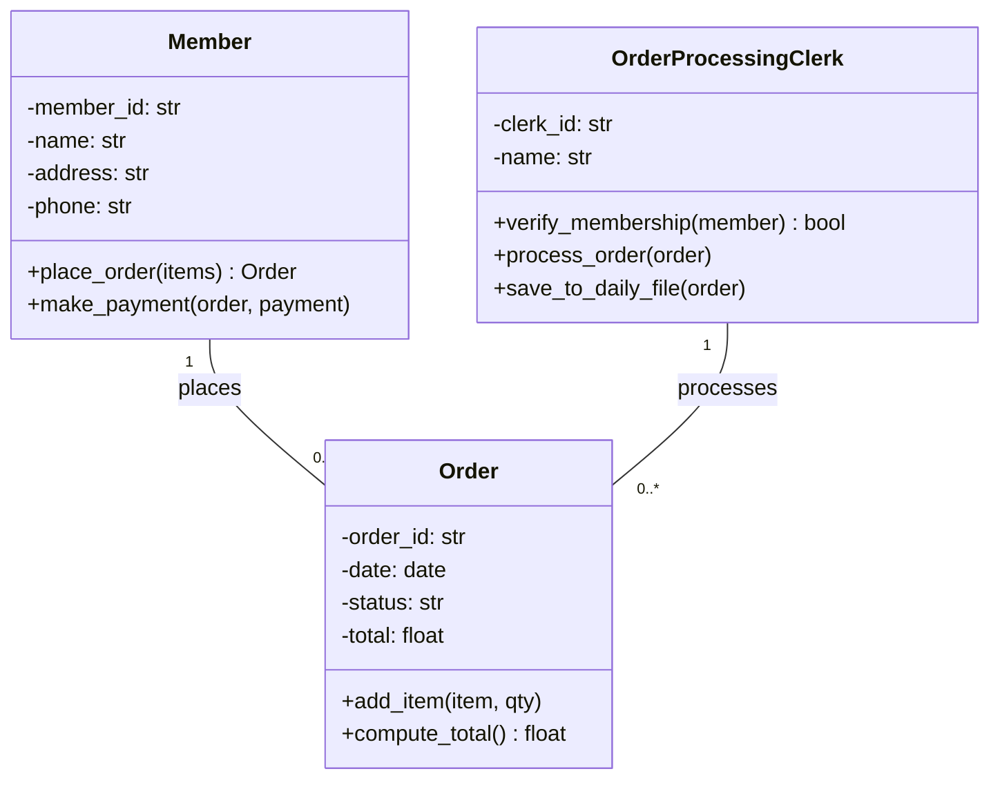
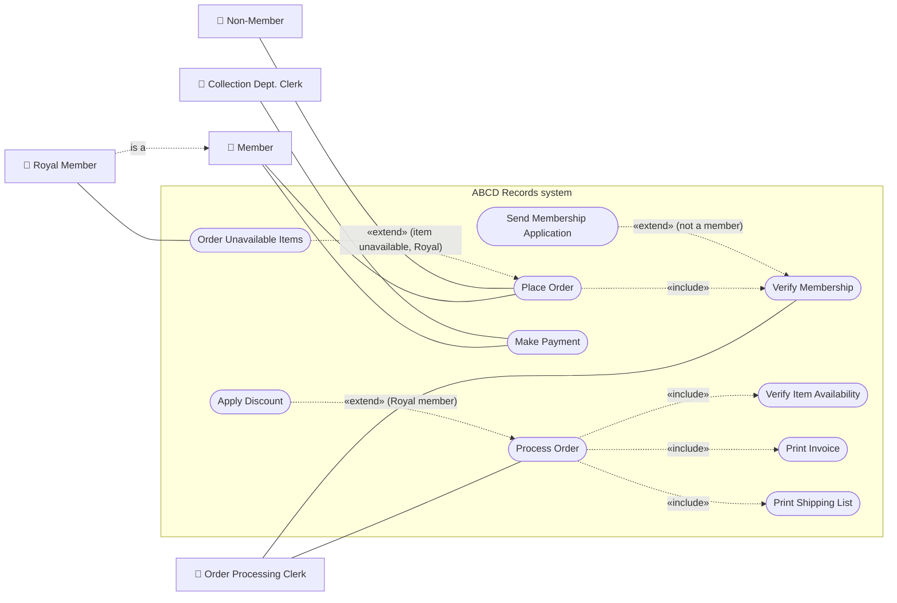
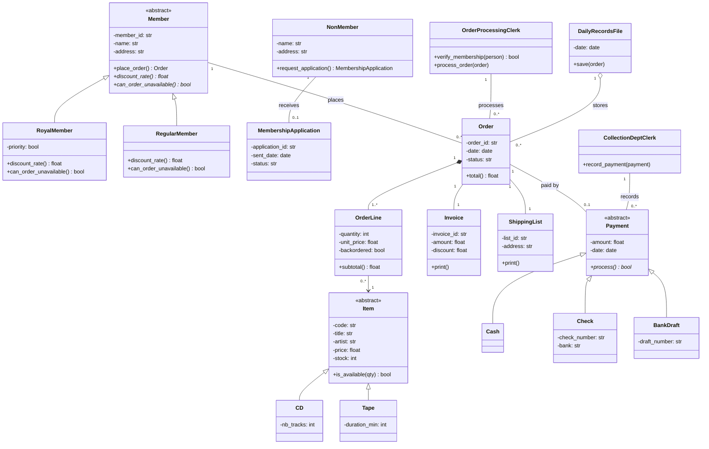
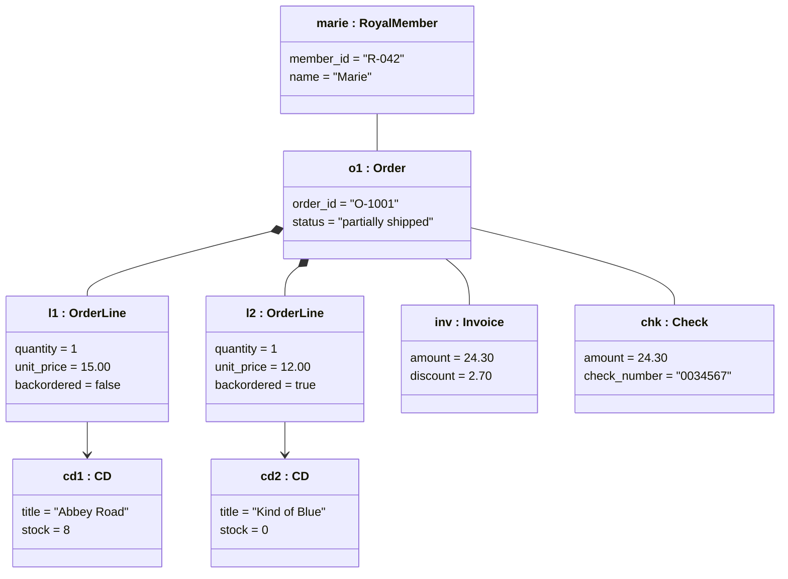
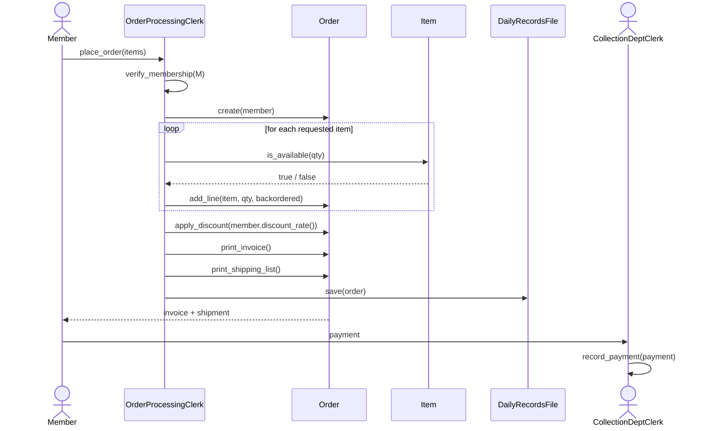
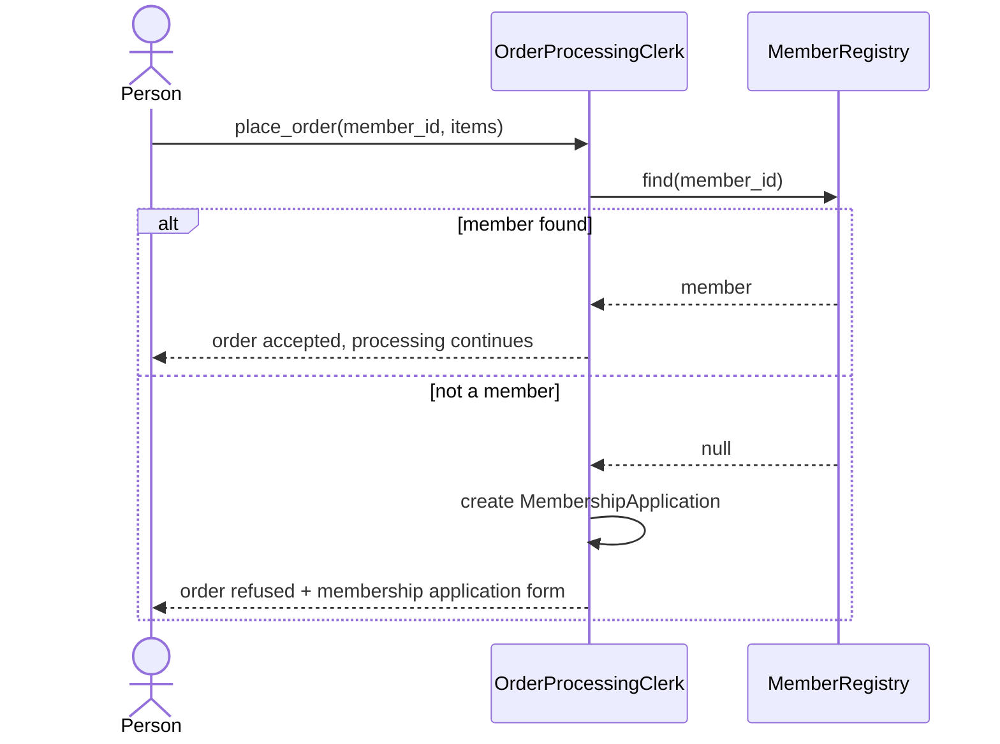
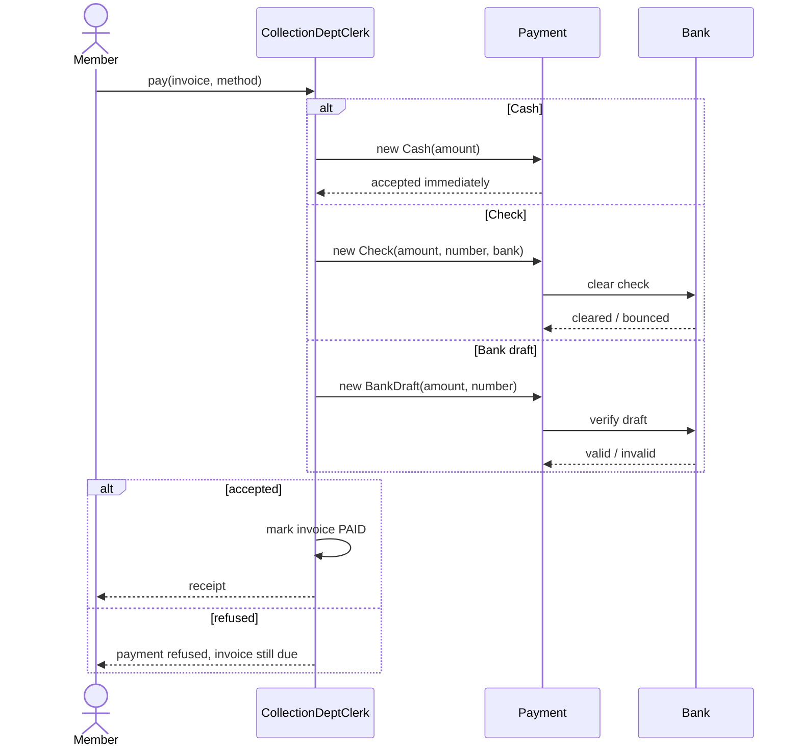
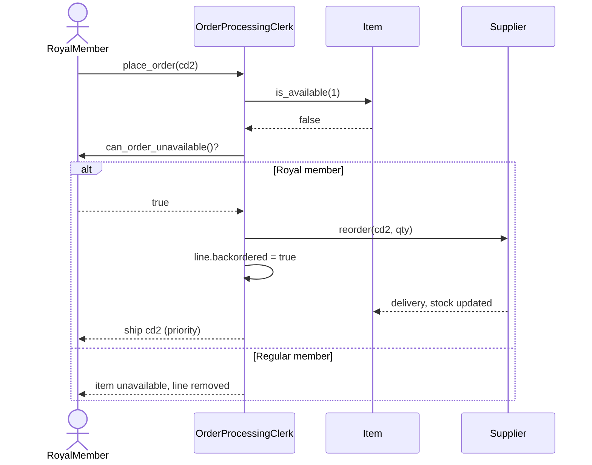

# UML Exo 2 - ABCD Records 📼

Statement: https://gist.github.com/bdallard/2d2407c4de4c182afca6d3ec7235e9eb

> Mermaid has no native use-case diagram, so use cases are drawn as rounded nodes
> inside a `subgraph` that plays the role of the system boundary.

## Level 1

### Task 1.1 - Use case diagram

### Task 1.2 - Class diagram

## Level 2

### Task 2.1 - Complete use case diagram

- **«include»**: always happens. Every order is checked for membership; every
  processed order checks availability and prints an invoice and a shipping list.
- **«extend»**: only under a condition. Discount only for Royal members, ordering
  unavailable items only for Royal members, and the application form only when
  the person is not a member.

### Task 2.2 - Complete class diagram

### Scenario - Royal member orders 2 CDs (one unavailable), pays by check

Object diagram of the state after the order is processed:

27.00€ of CDs minus the 10% Royal discount = **24.30€**. `cd2` is out of stock, but
Marie is Royal, so the line is kept as *backordered* instead of being refused.

## Level 3 - Sequence diagrams

### 1. Complete order processing flow

### 2. Membership verification (success and failure)

### 3. Payment processing (all types)

### 4. Item reordering for Royal members

