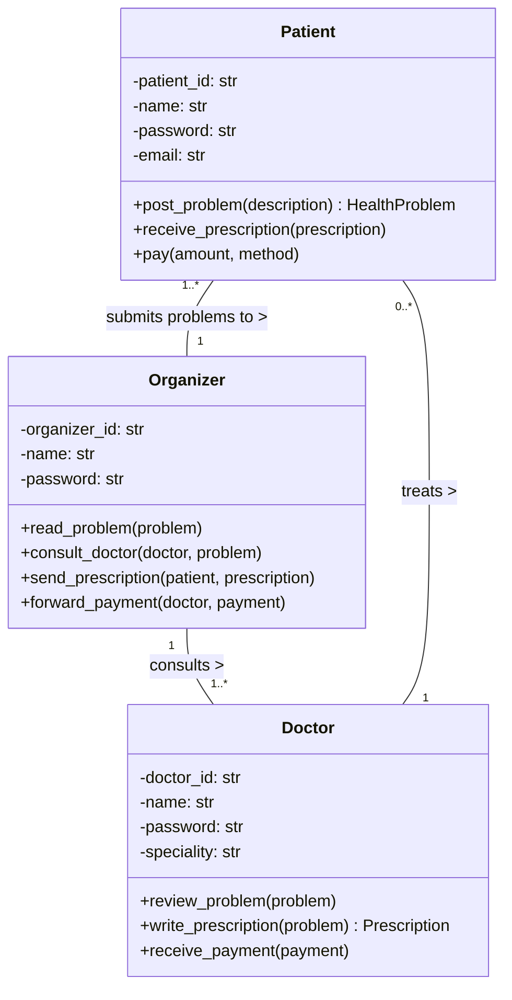
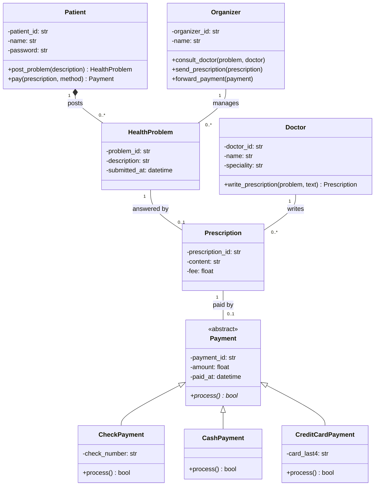
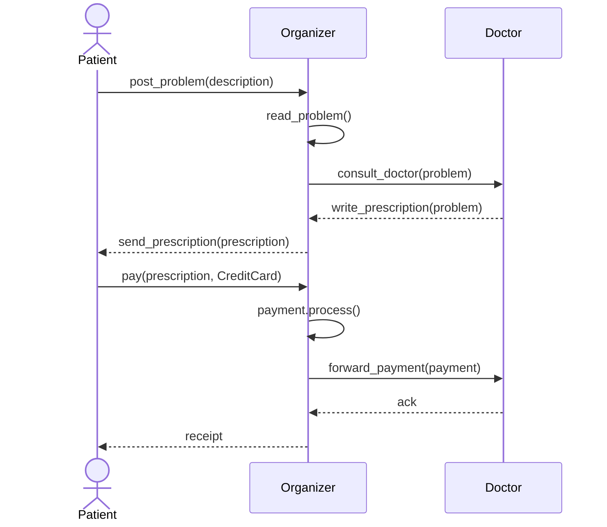
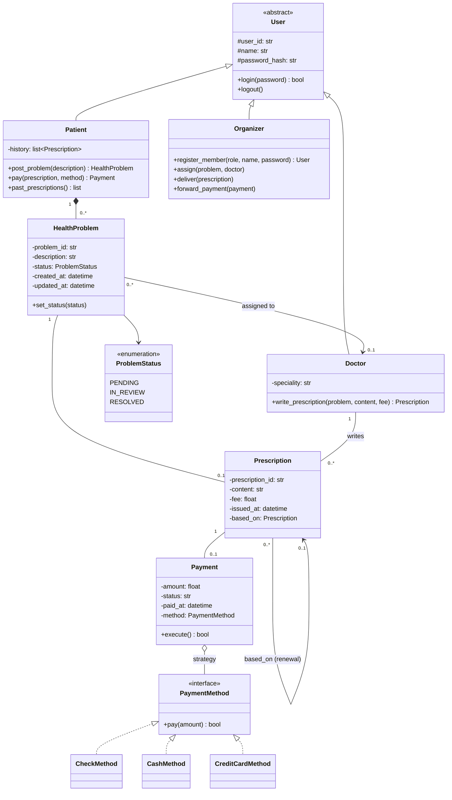
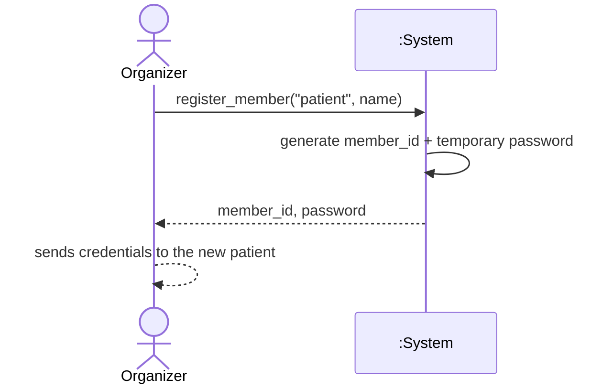
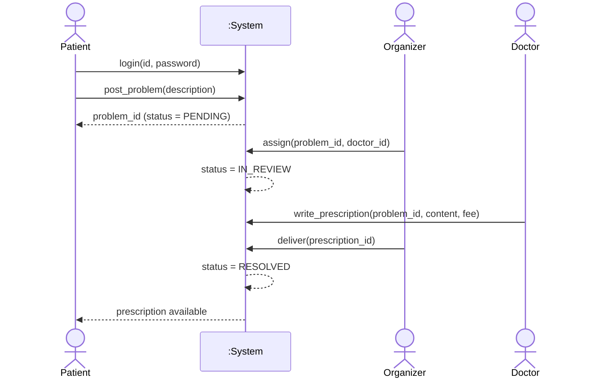
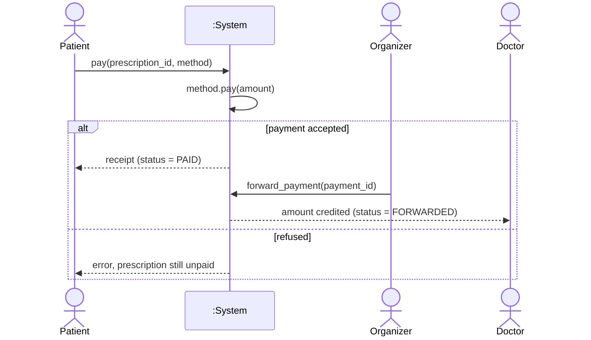

# UML Exo 1 - Hospital Management System 🏥

Statement: https://gist.github.com/bdallard/2d2407c4de4c182afca6d3ec7235e9eb
Implementation of the final design: [`hospital.py`](hospital.py)

## Task 1 - Basic class diagram

- An organizer handles many patients and consults many doctors.
- A doctor can treat zero or more patients; a patient deals with one organizer.

## Task 2 - Full class diagram (6 classes)

- **Composition** Patient ◆ HealthProblem: a problem has no meaning without its patient.
- **Inheritance** for payment types: each type has its own data (check number, card)
  and its own `process()`.

### Sequence diagram - submit a problem, get a prescription, pay

## Task 3 - Advanced design

### SSD 1 - Patient registration

### SSD 2 - Consultation flow

### SSD 3 - Payment processing

## Questions to consider

1. **Multiple doctors per patient?** The link is through `HealthProblem`: each
   problem is assigned to one doctor, so a patient with several problems can see
   several doctors (Patient 1 → * HealthProblem * → 0..1 Doctor). For a second
   opinion on the *same* problem, make the assignment a `Consultation` association
   class (problem, doctor, date, notes), giving HealthProblem 1 → * Consultation.
2. **Reusable prescriptions?** Yes for renewals: a new `Prescription` points to the
   one it is `based_on`, so the history is kept and each renewal has its own date
   and fee. The patient's `past_prescriptions()` gives the doctor that history.
3. **Design pattern for payments?** **Strategy**: `Payment` holds a
   `PaymentMethod` interface and calls `pay()` without knowing if it is check,
   cash or card. A new method (e.g. Apple Pay) is a new class, with no change to
   `Payment` (Open/Closed). A Factory can create the right method from a string.
4. **Data integrity during payment?** Treat a payment as a transaction with
   explicit states (PENDING → PAID → FORWARDED): the amount must equal the
   prescription fee, a prescription can be paid only once, forwarding is allowed
   only after PAID, and every step is timestamped. In a real system these updates
   are done in one database transaction so a crash never leaves "paid but not
   recorded".
