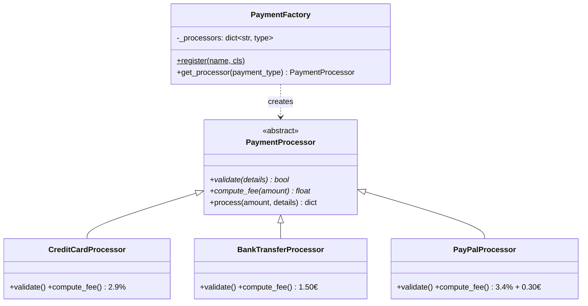
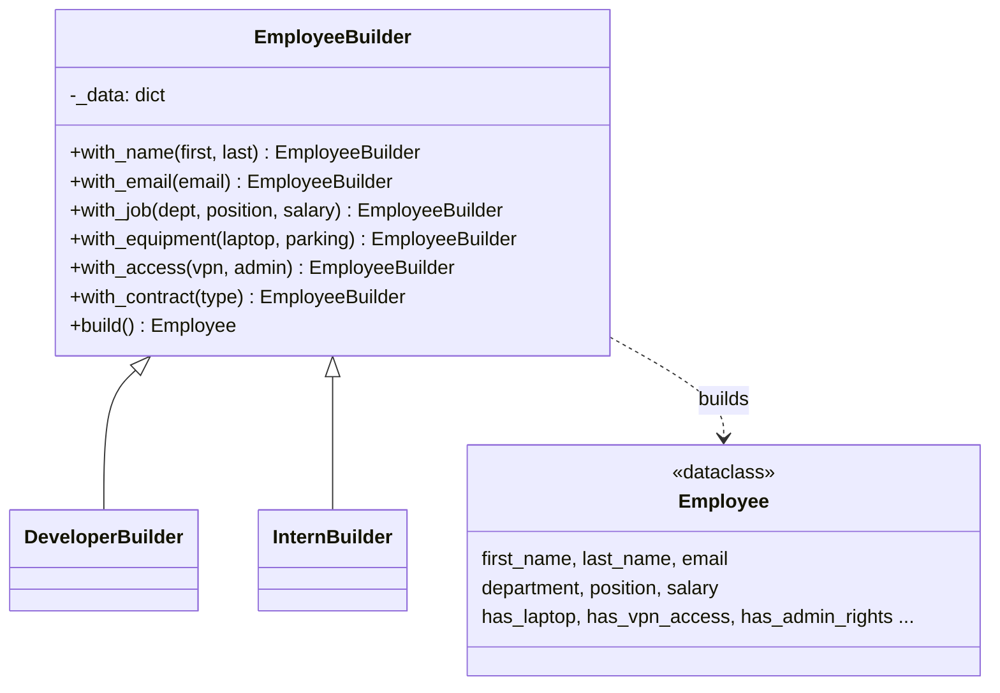
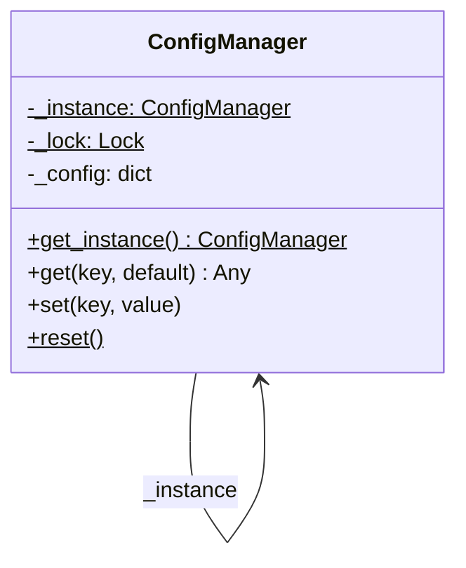
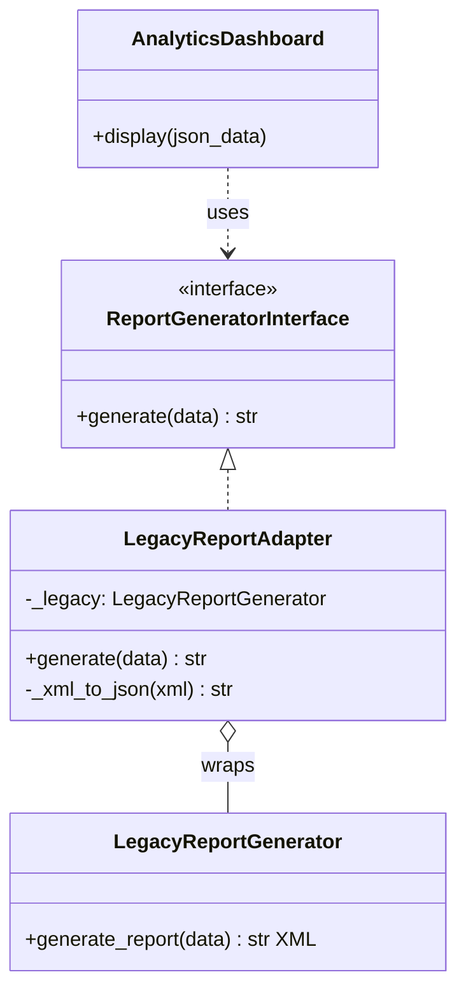
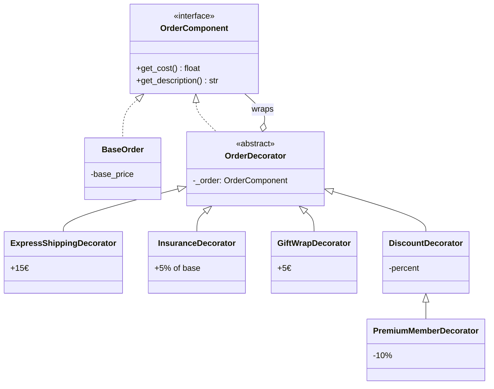
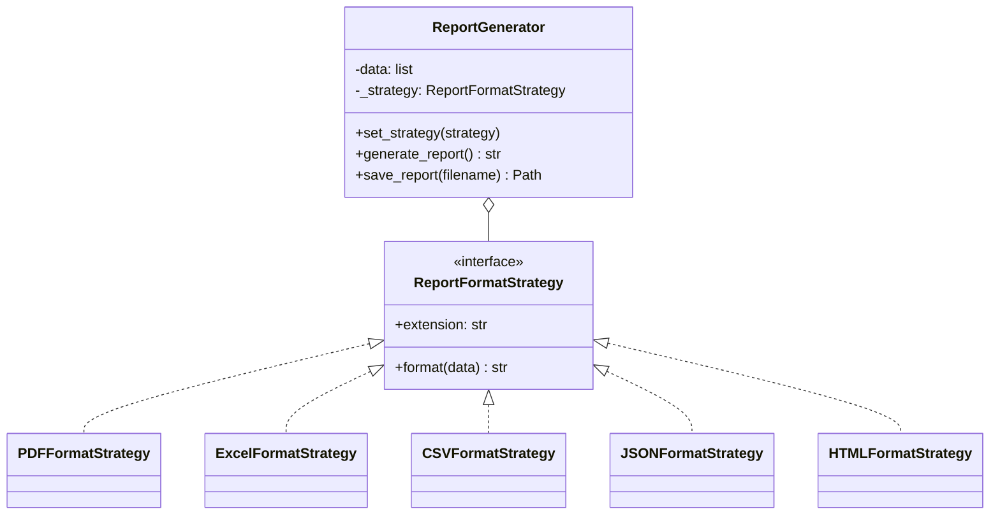
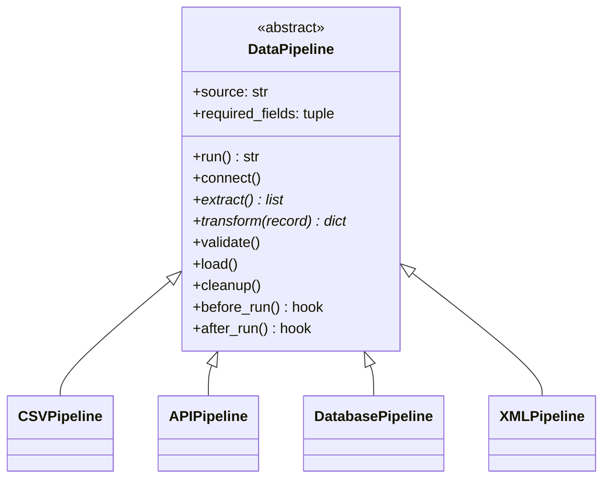

# Exercise 5 - Design patterns in practice (slide 84)

Statements:
[creational](https://courses.dallard.tech/sys_design/creational_pattern/) ·
[structural](https://courses.dallard.tech/sys_design/structural_pattern/) ·
[behavioral](https://courses.dallard.tech/sys_design/behavioral_pattern/)

Each exercise asks for a UML class diagram **before** coding; they are below, next to the code.

| Family | Pattern | Exercise | Code |
|---|---|---|---|
| Creational | Factory Method | Payment system | [`creational/factory_payment.py`](creational/factory_payment.py) |
| Creational | Builder | HR employee onboarding | [`creational/builder_employee.py`](creational/builder_employee.py) |
| Creational | Singleton | Configuration manager | [`creational/singleton_config.py`](creational/singleton_config.py) + [`config.json`](creational/config.json) |
| Structural | Adapter | Legacy XML report → JSON dashboard | [`structural/adapter_report.py`](structural/adapter_report.py) |
| Structural | Decorator | Order pricing | [`structural/decorator_order.py`](structural/decorator_order.py) |
| Behavioral | Strategy | Multi-format reports (+ HTML) | [`behavioral/strategy_report.py`](behavioral/strategy_report.py) |
| Behavioral | Template Method | ETL pipelines (+ XML) | [`behavioral/template_method_etl.py`](behavioral/template_method_etl.py) |

Run any file with `python3 <file>.py` from its folder.

---

## Factory Method - payment system

**Problem:** one `process_payment` function with an `if/elif` per method. Adding Apple
Pay means opening and editing it, which breaks the Open/Closed Principle.

The factory uses a dictionary instead of an if/else chain; `register()` adds a new
method (Apple Pay is added in the demo) without touching existing code.

## Builder - employee onboarding

**Problem:** a 17-parameter "telescoping constructor": one missing `None` shifts every
argument, `False, True, True` is unreadable, and rules like "a senior dev gets admin
rights" must be remembered at every call.

Every `with_*` returns `self` so calls chain; all validation happens once in `build()`.
The presets (`DeveloperBuilder`, `InternBuilder`) hold the hidden business rules.

## Singleton - configuration manager

**Problem:** `config.json` is read from disk 4 times per request, every module has its
own copy (changes aren't shared), and there is no single point to mock in tests.

The file is loaded once, on the first `get_instance()`. `get("database.host")` reads
nested keys. A lock makes it safe with threads, and `reset()` lets tests load a fake config.

## Adapter - legacy XML reports

**Problem:** the legacy generator returns XML, the dashboard expects JSON, the legacy
library can't be modified, and each function re-does (in fact fakes) the conversion.

The adapter actually parses the XML output (and restores number types), instead of
cheating with the original dictionary like the legacy code did.

## Decorator - order pricing

**Problem:** 5 boolean flags in one method, a new option means editing it, and the order
of operations (discount before or after shipping?) is hidden.

The wrapping order is now the order of operations, visible in the code. The demo gives
95.62€, the same total as the original function.

## Strategy - report formats

Problems found (also listed at the top of the file): the if/elif on the format is
duplicated in two methods; a new format means editing the class (Open/Closed); no
format can be tested alone; switching format at runtime is clumsy; "excel" is plain
text saved as `.xlsx`.

**Extensibility test passed:** `HTMLFormatStrategy` was added without changing any existing class.

## Template Method - ETL pipelines

Problems found: validation, load and cleanup are copy-pasted 3 times; adding logging
or changing the step order means editing every class; nothing forces a new pipeline to
validate or clean up.

`run()` fixes the order (connect → extract → transform → validate → load → cleanup).
Subclasses only write `extract` and `transform` and declare their required fields.
**Validation:** the new `XMLPipeline` really parses XML and uses the `before_run` hook.
